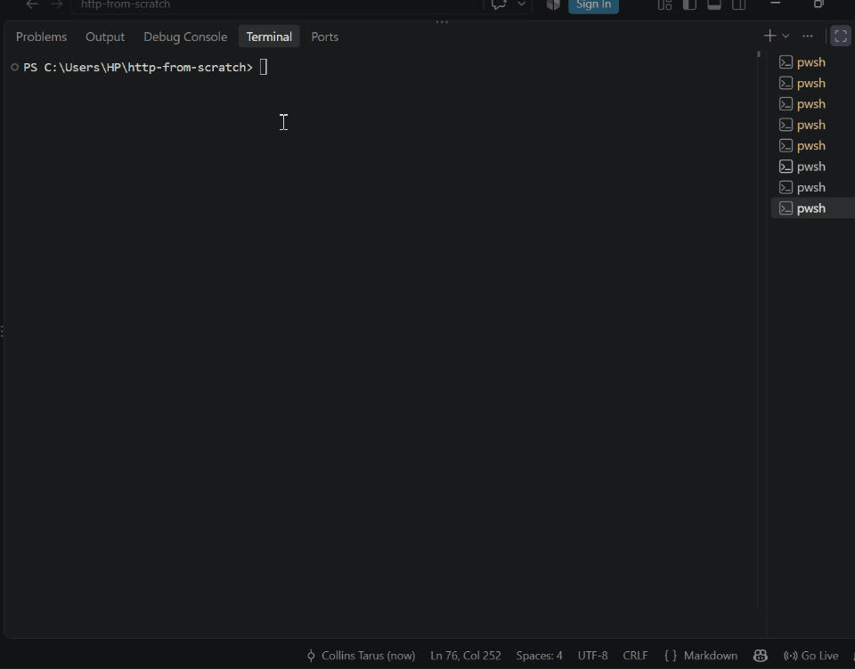

# HTTP Server From Scratch


A multi-threaded HTTP/1.1 web server built directly on raw TCP sockets in Python, with no web frameworks. I built it to understand how the web works underneath.

## Features

- Reads and parses HTTP requests by hand (method, path, version, headers)
- Routing for `/`, `/about` and `/headers` (which echoes the request headers back)
- Correct status codes: `200`, `404`, and `400` for malformed requests
- One thread per connection, so one slow client never blocks the others
- 5-second timeout on silent connections
- Automated unit and integration tests (pytest), run on every push with GitHub Actions
- Serves static files from `public/`, with path traversal blocked (`403 Forbidden`)
- Reverse proxy with round-robin balancing, health checks and automatic failover (`proxy.py`)
- One-command demo of the whole setup (`demo.py`), also run in CI
## How a request flows

```
Browser --TCP--> accept() --> new thread --> parse_request() --> route() --> make_response() --> Browser
```

| Step | What happens |
|---|---|
| `accept()` | The main loop waits for a client to connect. |
| new thread | The connection is handed to its own thread, and the loop goes back to waiting. |
| `parse_request()` | Raw bytes become a method, path, version and headers dictionary. |
| `route()` | The path decides the status and the body. |
| `make_response()` | Builds the HTTP response with a correct `Content-Length`. |

## Quick start

```
python server.py
```

Then open http://127.0.0.1:8080 in your browser.

| Path | Response |
|---|---|
| `/` | `200` Welcome message |
| `/about` | `200` About message |
| `/headers` | `200` The headers your browser sent |
| anything else | `404` Page not found |
## Benchmarks

Measured with `benchmark.py` on my laptop (Windows, Python 3.14), client and server on the same machine:

| Concurrent clients | Requests | Requests/sec | Avg latency | p95 latency |
|---|---|---|---|---|
| 10 | 2000 | 2002 | 4.4 ms | 12.0 ms |
| 50 | 5000 | 2617 | 18.9 ms | 28.3 ms |

Run it yourself: start the server, then `python benchmark.py 10 200`.
## Load balancer demo

`proxy.py` is a reverse proxy that spreads requests across several copies of the server (round-robin) and automatically stops sending traffic to any copy that fails its health check.

```
python server.py --port 9001
python server.py --port 9002
python proxy.py
```

Then `curl http://127.0.0.1:8080/whoami` alternates between the two ports. Stop one backend and every request is served by the other within seconds. Start it again and it rejoins on its own.

- Active health checks: `GET /health` on every backend every 2 seconds
- Passive detection: a failed forward marks that backend down immediately and retries on the next one
- `503` only when every backend is down
### One-command demo

```
python demo.py
```

Starts two backends and the proxy, shows requests alternating, stops one backend (no request fails), then starts it again and watches it rejoin. Add `--serve` to leave everything running so you can try it in a browser. CI runs this demo on every push.

## Run the tests

```
python -m pip install pytest
python -m pytest -v
```

The suite has unit tests for the parser, router and response builder, plus integration tests that start the real server and check `200`, `404`, `400`, and that a silent client does not block other visitors.

## Design decisions

- **Thread per connection.** It is simple and easy to reason about. The trade-off is that every thread costs memory, so it will not scale to thousands of simultaneous clients. An event-loop version is on the roadmap.
- **5-second socket timeout.** Without it, a client that connects and says nothing would hold a thread forever.
- **`Connection: close` on every response.** One request per connection keeps the code simple, at the cost of speed compared with keep-alive.
- **Bad input never crashes the server.** Malformed requests get a `400`, and any unexpected error is caught and logged for that one connection only.
- **No `SO_REUSEADDR` on Windows.** On Windows it lets two servers silently share one port, which hid a real bug during development.

## Roadmap

- [x] Raw socket server with request parsing and routing
- [x] Error handling (`400`, `404`)
- [x] Concurrency with threads and timeouts
- [x] Automated tests and CI
- [x] Benchmarks (requests per second)
- [x] Serve static files safely (blocking `../` path tricks)
- [ ] Keep-alive connections
- [ ] Event-loop version (`selectors`) compared against threads
- [x] Reverse proxy and load balancer with health checks